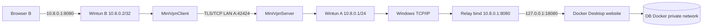

# Giai đoạn 1–2: điều kiện chạy và kiến trúc

## Khảo sát trong workspace hiện tại

- Windows `10.0.26200`; .NET SDK `10.0.401`, runtime `10.0.12`.
- Phiên làm việc hiện tại **không có quyền Administrator**. Truy vấn `Get-NetIPAddress` và `Get-NetAdapter` bị từ chối quyền, nên chưa xác định được IP LAN.
- Không tìm thấy lệnh `docker` và `wintun.dll` ở các vị trí thông dụng. Chưa có laptop B để thử LAN.
- Chạy `powershell -ExecutionPolicy Bypass -File .\scripts\Preflight.ps1 -WintunDll .\wintun.dll` **trên cả A và B**, trong PowerShell Administrator. Gửi kết quả để chốt điều kiện thực tế. A cần Docker Desktop Linux containers chạy được (`docker version` và `docker compose version`); cả hai cần .NET 10 và Wintun x64.
- Các thao tác cần Administrator: tạo Wintun adapter, gán IP và route, cấu hình Windows Firewall. Docker Desktop phải được cài và chạy trên A. IP LAN hai máy phải ping hoặc kết nối TCP trực tiếp được, không có Wi-Fi client isolation.

## Đường đi dữ liệu dự kiến

Gói về đi ngược: website → Docker Desktop publish loopback → relay trên A → TCP/IP Windows nguồn `10.8.0.1`, đích `10.8.0.2` → Wintun A → server chọn phiên theo IP đích → TLS → client → Wintun B → browser. Relay tạo **một kết nối TCP mới** tới website loopback; nó không định tuyến trực tiếp vào mạng container. Docker phải publish `127.0.0.1:18080`, DB không publish. [Docker xác nhận host IP trong Compose](https://docs.docker.com/get-started/docker-concepts/running-containers/publishing-ports/) và [mô tả đường publish trên Desktop](https://docs.docker.com/desktop/features/networking/).

| Thành phần | Địa chỉ/cổng | Kiểm soát |
| --- | --- | --- |
| TLS server A | IP LAN A:42424 | Windows Firewall chỉ cho IP LAN B; TLS và xác thực VPN |
| Wintun A | 10.8.0.1/24 | Server chỉ nhận IPv4 nguồn đã cấp, đích 10.8.0.1, TCP 8080 hoặc ICMP echo |
| Wintun B | 10.8.0.2/32 hoặc .3/32 | Route on-link `10.8.0.1/32`, không đổi default gateway |
| Relay A | 10.8.0.1:8080 | Chỉ chấp nhận IP phiên VPN đang hoạt động |
| Website Docker | 127.0.0.1:18080 | Chỉ A truy cập trực tiếp; LAN B không thấy cổng này |
| DB Docker | mạng Compose nội bộ | Không publish ra host |

Trước khi đi tiếp giai đoạn website, phải kiểm tra trên máy thật rằng Wintun có thể tạo, Windows gán IP/route đúng, `Test-NetConnection 10.8.0.1 -Port 8080` trên B thành công sau xác thực và thất bại trước/sau. Việc bind relay tại `10.8.0.1` trên Windows và đường trả qua Wintun **chưa kiểm chứng trên máy thật**. [Wintun API](https://git.zx2c4.com/wintun/tree/api/wintun.h) cung cấp đọc/ghi packet; [Windows New-NetRoute](https://learn.microsoft.com/en-us/powershell/module/nettcpip/new-netroute) hỗ trợ route theo interface index. TLS/TCP chứa TCP có thể gây head-of-line blocking và giảm thông lượng khi mất gói, phù hợp phạm vi demo chứ không phải VPN hiệu năng cao.
